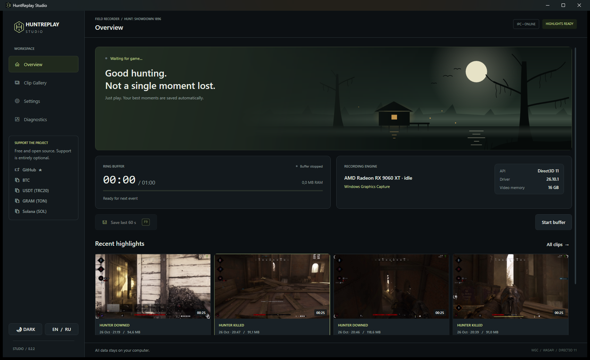

# HuntReplay Studio



[English](#english) | [Русский](#русский)

---

<a name="english"></a>
## English

**HuntReplay Studio** is a standalone, lightweight, zero-impact clip recorder designed specifically for **Hunt: Showdown 1896**. 

It automatically captures highlights (kills, deaths, downs) directly from the game's official Highlights SDK events, using hardware GPU encoding and Windows Graphics Capture (WGC). Works seamlessly on **AMD, Intel, and NVIDIA GPUs**.

### ✨ Features
- **Zero Injections & Anti-Cheat Safe**: Connects only through the standard NVIDIA MessageBus IPC pipe (`\\.\pipe\NvMessageBusBroadcast`). Uses an authentic signed `MessageBus.dll`. Zero keypress emulation, zero DLL hooking into the game process.
- **Hardware GPU Encoding**: Supports **NVIDIA NVENC**, **AMD AMF**, **Intel QSV**, and CPU (x264). Up to 120 FPS at 1080p, 1440p, or 4K.
- **Lossless Smart Trim**: Saves clips directly from a circular RAM ring buffer with keyframe-accurate trimming. No video re-encoding upon save.
- **Multi-Kill Coalescing**: Automatically stitches consecutive kills into a single action-packed highlight.
- **Standalone Portable EXE**: Single `.exe` binary with everything built-in. No Python, OBS, FFmpeg installations, or runtime dependencies required.
- **Dark Theme Gallery & Built-in Player**: Built-in 16:9/16:10 video player with sleek playback controls, instant search, renaming, and folder reveal.
- **NVIDIA Safety Safeguards**: Automatically detects if the official NVIDIA Container (`nvcontainer.exe`) is running and pauses its own IPC server to avoid conflicts.

### 🚀 Getting Started

1. Download the latest `HuntReplayStudio.exe` from [Releases](https://github.com/Mlovo/HuntOpenHighlights/releases).
2. Run `HuntReplayStudio.exe`.
3. Complete the quick initial setup wizard (confirms NVIDIA MessageBus registration).
4. Play! Clips will be saved automatically upon kills and downs into your configured library directory.

> **Note for NVIDIA Users:**  
> If you have GeForce Experience or NVIDIA App installed, disable auto-highlights in their overlay settings (*Settings ➔ Highlights ➔ Off*) so they don't conflict with HuntReplay Studio.

### 🛠 Building from Source
**Requirements:** Windows 10/11 x64, .NET 8 SDK, CMake 3.25+, Visual Studio 2022 / Build Tools (C++ workload).

```powershell
powershell -ExecutionPolicy Bypass -File .\tools\Build.ps1
```
The output portable executable will be placed in `artifacts\publish\HuntReplayStudio.exe`.

---

<a name="русский"></a>
## Русский

**HuntReplay Studio** — легковесный автономный рекордер хайлайтов, созданный специально для **Hunt: Showdown 1896**.

Автоматически сохраняет моменты убийств и смертей через официальный протокол событий игры, используя аппаратное кодирование на видеокарте и Windows Graphics Capture (WGC). Работает на видеокартах **AMD, Intel и NVIDIA**.

### ✨ Возможности
- **Безопасно для античита (EAC)**: Подключение происходит исключительно через официальный протокол NVIDIA MessageBus (`\\.\pipe\NvMessageBusBroadcast`). Используется оригинальная библиотека с официальной цифровой подписью NVIDIA. Без инжектов в процесс игры и без эмуляции нажатий клавиш.
- **Аппаратное GPU-кодирование**: Поддержка **AMD AMF**, **NVIDIA NVENC**, **Intel QSV** и программного x264. Запись до 120 FPS в разрешениях 1080p, 1440p и 4K.
- **Lossless Smart Trim**: Клипы сохраняются из циклического буфера в оперативной памяти с точной привязкой к ключевым кадрам без повторного перекодирования.
- **Объединение серий убийств**: Несколько убийств подряд автоматически склеиваются в один непрерывный динамичный хайлайт.
- **Один портативный EXE-файл**: Никаких сторонних программ, Python, OBS или кодеков устанавливать не нужно — всё встроено в один файл.
- **Встроенная галерея и видеоплеер**: Удобный плеер с перемоткой, поиском по клипам, переименованием и открытием папки с файлами.
- **Защита от конфликтов с NVIDIA**: Программа автоматически проверяет статус официальной службы NVIDIA (`nvcontainer.exe`) и предотвращает конфликты с GeForce Experience / NVIDIA App.

### 🚀 Быстрый старт

1. Скачайте свежий `HuntReplayStudio.exe` из раздела [Releases](https://github.com/Mlovo/HuntOpenHighlights/releases).
2. Запустите `HuntReplayStudio.exe`.
3. Пройдите мастер первоначальной настройки (подтвердит регистрацию MessageBus).
4. Играйте! Клипы будут сохраняться автоматически в настроенную папку библиотеки.

> **Примечание для владельцев видеокарт NVIDIA:**  
> Если у вас установлен GeForce Experience или NVIDIA App, отключите автоматическую запись хайлайтов в оверлее (*Настройки ➔ Highlights ➔ Выключить*), чтобы они не спорили за события игры.

### 🛠 Сборка из исходников
**Требования:** Windows 10/11 x64, .NET 8 SDK, CMake 3.25+, Visual Studio 2022 (компоненты C++).

```powershell
powershell -ExecutionPolicy Bypass -File .\tools\Build.ps1
```
Готовый исполняемый файл появится в `artifacts\publish\HuntReplayStudio.exe`.

---

## 📜 Лицензия
Проект распространяется под лицензией [MIT](LICENSE). Подробности сторонних компонентов смотрите в [THIRD_PARTY_NOTICES.md](THIRD_PARTY_NOTICES.md).
